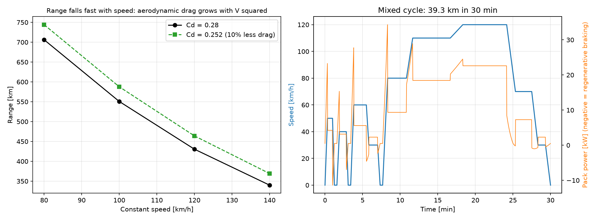
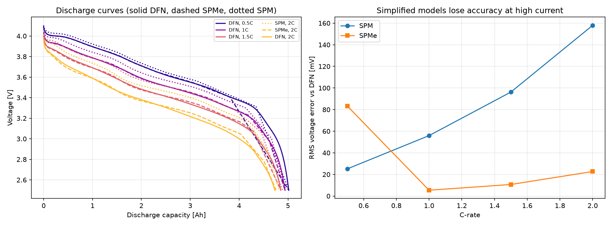
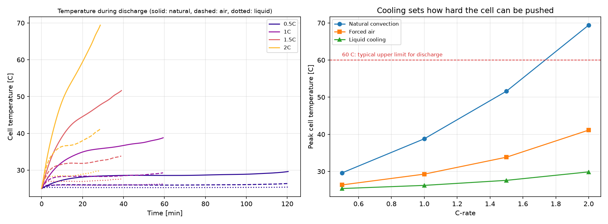
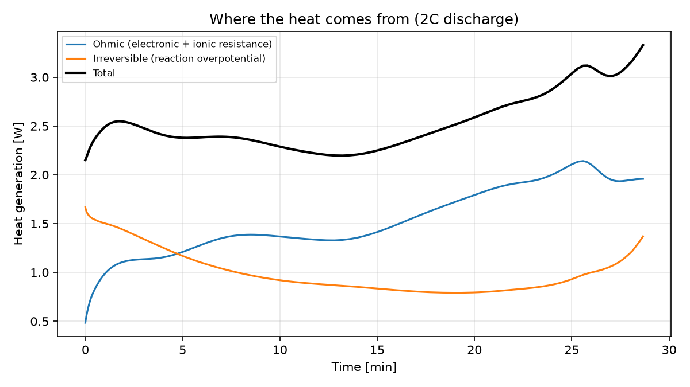
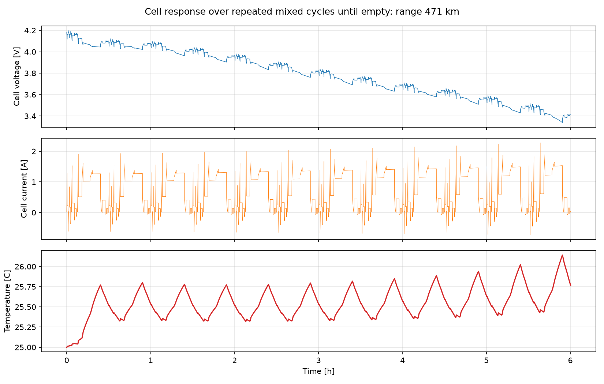

# EV Battery Cell Modelling with PyBaMM: from Electrochemistry to Vehicle Range

Electrochemical simulation of a real automotive lithium-ion cell, the **LG M50 21700** (5 Ah, NMC811 cathode, graphite-SiOx anode), with [PyBaMM](https://pybamm.org/). The study goes from the physics inside the cell to the range of an electric car: model fidelity, heat generation, cooling, and how vehicle speed and aerodynamic drag change the range. Everything runs from one Python script in under two minutes.



## What is modelled

| Item | Value |
|---|---|
| Cell | LG M50 21700, 5 Ah nominal, parameter set Chen2020 (measured and published by Chen et al., 2020) |
| Electrochemical models | Single Particle Model (SPM), SPM with electrolyte (SPMe), Doyle-Fuller-Newman (DFN) |
| Thermal model | Lumped: cell heat capacity plus convective cooling to a 25 °C ambient |
| Cooling levels | Natural convection (h = 10 W/m²K), forced air (40), liquid cooling (150) |
| Vehicle | 1900 kg, Cd = 0.28, frontal area 2.3 m², Crr = 0.009, drivetrain efficiency 90%, regenerative braking 60%, auxiliaries 500 W |
| Pack | 96s46p = 4416 cells, about 400 V and 80 kWh |

## 1. Model hierarchy: how much physics do you need?

The DFN model solves lithium diffusion inside the particles and ion transport through the electrolyte across the cell thickness. The SPM treats each electrode as one particle and ignores the electrolyte. The SPMe adds an electrolyte correction to the SPM.



| C-rate | SPM error vs DFN | SPMe error vs DFN |
|---|---|---|
| 0.5C | 25 mV | 83 mV* |
| 1C | 56 mV | 5 mV |
| 1.5C | 96 mV | 11 mV |
| 2C | 158 mV | 23 mV |

RMS voltage error over the first 90% of the discharge.

- **The SPM error grows with current**, from 25 to 158 mV. At high current the electrolyte develops strong concentration gradients, and the SPM has no electrolyte at all.
- **The SPMe stays within 5 to 23 mV from 1C to 2C**, at about half the cost of the DFN. That makes it the right choice for the long vehicle simulations below, where currents stay below 1C.
- \*At 0.5C, the SPMe follows the DFN within a few millivolts for most of the discharge, but its end-of-discharge knee comes about 0.4 Ah early (the dashed curve), and that knee dominates the RMS value. A good reminder to look at the curves and not only at a single error number.

## 2. Heat generation and cooling



| C-rate | Peak temperature, natural convection | Forced air | Liquid cooling |
|---|---|---|---|
| 0.5C | 29.6 °C | 26.4 °C | 25.4 °C |
| 1C | 38.8 °C | 29.3 °C | 26.2 °C |
| 1.5C | 51.6 °C | 33.8 °C | 27.6 °C |
| 2C | **69.4 °C** | 41.1 °C | 29.9 °C |

Heat generation grows roughly with the square of the current (I²R), so the temperature rise accelerates with C-rate. With only natural convection, a 2C discharge pushes the cell to 69 °C, above the usual 60 °C limit for discharge. Liquid cooling keeps the same discharge below 30 °C. The cooling system, not the cell chemistry, sets how hard the pack can be pushed.



### Energy balance check

At 2C with natural convection, the electrical energy lost in the cell, ∫ I·(OCV_surface − V) dt = **4290 J**, matches the ohmic plus irreversible reaction heat computed by the model, **4348 J (+1.4%)**.

Using the bulk open-circuit voltage instead gives 7041 J. The extra 2751 J is not lost: it is energy stored in the lithium concentration gradients inside the electrode particles, which relaxes after the discharge ends. Coulomb counting closes exactly: the integral of current equals the reported capacity (4.7772 Ah).

## 3. Electric vehicle application

A road-load model turns vehicle speed into battery power, P = (m·a + ½·ρ·Cd·A·v² + Crr·m·g)·v / η, plus auxiliaries, with regenerative braking when the power is negative. The pack power is divided by the 4416 cells, and the SPMe-thermal model runs the cell until it reaches the 2.5 V cut-off.

| Speed | Pack power | Cell power | Range | Range with 10% less drag | Gain |
|---|---|---|---|---|---|
| 80 km/h | 9.4 kW | 2.12 W | 706 km | 744 km | +5.4% |
| 100 km/h | 14.9 kW | 3.37 W | 551 km | 588 km | +6.7% |
| 120 km/h | 22.6 kW | 5.12 W | 431 km | 464 km | +7.8% |
| 140 km/h | 33.0 kW | 7.47 W | 340 km | 369 km | +8.6% |

- **Going from 80 to 140 km/h halves the range** (706 to 340 km). The aerodynamic drag force grows with v², so the power grows with v³.
- **Aerodynamics matters more the faster you go:** a 10% drag reduction adds 5.4% of range at 80 km/h but 8.6% at 140 km/h, because drag is a larger share of the total resistance at high speed.

### Mixed driving cycle

A 30-minute synthetic cycle (city stop-and-go, suburban and highway up to 120 km/h, 39.3 km, average 79 km/h) is repeated until the battery is empty: peak pack power 34 kW, peak regeneration 11 kW. **Range: 471 km in 6.0 hours of driving**, with a peak cell temperature of only 26.1 °C, because normal driving asks less than 0.3C from each cell.



## Rate capability

| C-rate | Capacity delivered (natural convection) | Energy per cell |
|---|---|---|
| 0.5C | 5.018 Ah | 18.09 Wh |
| 1C | 4.947 Ah | 17.42 Wh |
| 1.5C | 4.874 Ah | 16.78 Wh |
| 2C | 4.777 Ah | 16.05 Wh |

Faster discharge delivers less charge and less energy, because the overpotentials pull the voltage down to the cut-off sooner. The energy falls faster than the capacity because the average voltage is also lower.

## How to run

```bash
pip install pybamm matplotlib
python ev_battery.py
```

About 2 minutes on a desktop PC. Figures and the report are written to `results/`.

## Limitations

- The Chen2020 parameter set has weak temperature dependence, so cold-weather capacity loss is not captured. It also has no entropic coefficient, so reversible heat is zero.
- Lumped thermal model: one temperature per cell, no gradients inside the cell or across the pack.
- No ageing. The vehicle model is a simple road-load model, not a certified test cycle.
- Possible extensions: a pack-level thermal network with cell-to-cell variation, fast-charging protocols with a lithium-plating limit, and degradation over cycles.
